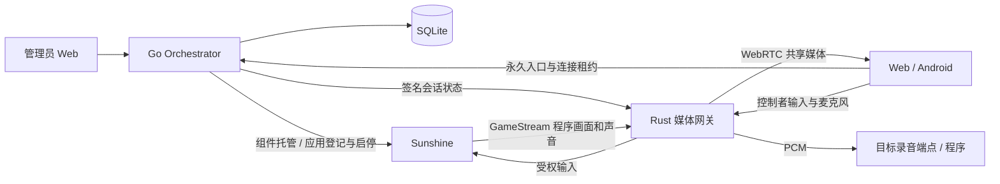
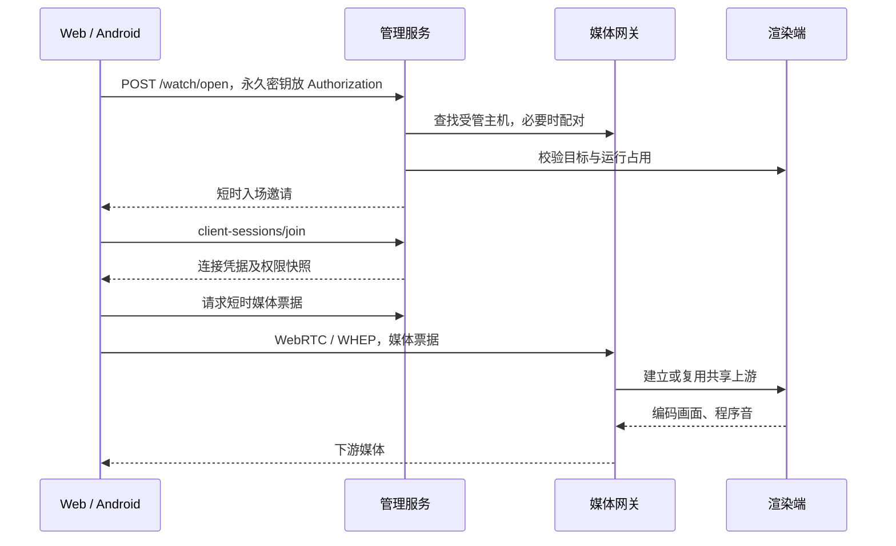

# Stream Kit 技术架构

本文描述当前单仓库实现及运行边界。源码路径均相对仓库根目录；精确 API 字段以对应源码及 `contracts/` 为准。发布和现场状态见[基线](release-status.md)，不在架构中重复追加构建流水。

## 组件与执行域

| 模块 | 源码位置 | 所有权 |
| --- | --- | --- |
| 管理服务 | `orchestrator/` | 应用元数据、组件生命周期、会话及连接、配置和管理 API |
| 管理前端 | `orchestrator/web/` | 服务器状态投影、编辑草稿、用户命令与操作反馈 |
| 渲染端 | `third_party/sunshine/` | 原生应用实例、采集目标、编码及系统输入 |
| 网关与 Web/PWA | `third_party/moonlight-web-stream/` | 共享上游、下游 WebRTC、媒体授权、混音与目标音频 |
| Android | `third_party/moonlight-android/` | 原生媒体、输入与生命周期；复用统一控制契约 |
| 音频组件 | `components/audio-target/` | 原生音频端点及 PCM 队列；开发 probe 不随产品交付 |
| 来源与协议 | `third_party-manifests/`、`contracts/` | 上游锁定、许可证、跨组件契约 |

管理服务不转发逐帧像素；渲染端负责采集编码，网关连接原生媒体与客户端 WebRTC。Moonlight Qt 源码保留在仓库中，但不是当前统一受管客户端的发布产物；不能让原版客户端独立直连绕过管理权限。旧 `docs/src/` 不是生产源目录。

## 核心数据所有者

| 数据 | 权威来源 | 关键边界 |
| --- | --- | --- |
| 应用、来源、参数、采集模式、观看密钥 | SQLite `App` | 应用 UUID 与原生 host/app ID 不可混用；观看密钥不进入普通 JSON |
| 原生运行实例 | Sunshine 已认证运行状态 | 绑定执行实例与程序身份，不能从缓存状态或 PID 文本猜测归属 |
| 渲染会话 | `session.Manager` / SQLite `StreamSession` | 会话 ID、revision、control_epoch、原生实例、准入期限 |
| 在线客户端 | 会话的 connections / 租约 | 连接不是永久用户或设备档案；私有 resumable 不作为在线投影 |
| 唯一控制者 | controller_connection_id + control_epoch | 转交/撤权推进权限代次，不能从媒体票据的旧 role 恢复权限 |
| 期望配置 | 受保护配置文件 + revision | 保存成功不等于当前进程已采用 |
| 媒体有效性 | 网关签名确认与新鲜运行观测 | 必须与当前会话/代次匹配，未知不当作运行正常 |
| 前端查询 | TanStack Query 投影 | 不成为第二份服务器权限来源 |

主要实现位于 `internal/model/`、`store/`、`session/`、`app/manager.go` 和 `mediacontrol/`。

## 应用发布与执行

归档上传先限制 HTTP 接收体，解包统一限制路径、文件类型、重复条目、条目数量、总展开大小和相应解码预算。Go 纳管解码器处理 ZIP/7z/RAR/TAR 及压缩 TAR；不执行系统解压命令。路径写入使用平台目录边界，失败执行所属临时文件清理。

`source=archive` 的程序由平台拥有；`source=local` 的入口/工作目录引用外部文件，平台只拥有其 UUID 注册目录。删除登记不能递归删除外部安装目录。Linux 本机程序须已有执行位；上传入口的执行权限由平台按规则准备。

应用状态包括上传、解压、检测、登记、ready、running、stopped、crashed 和错误；具体常量见 `internal/model/app.go`。启动/停止/删除/参数编辑在统一管理器协调，不能绕开正在进行的准入或原生实例确认。

启动查验组件、配置及主机占用，必要时执行受管自动配对，再获得目标 host/app 的准入。运行状态以原生实例为依据同步；应用退出不能靠客户端心跳无限保持 starting。修改参数需同时确认应用状态、非停止会话和原生运行状态均允许。

## 永久入口与凭据分层

永久密钥是应用持久能力，放在 `/watch#key=…` fragment，HTTP 访问日志不应包含它。管理员身份、永久入口、邀请、连接凭据、媒体票据和节点签名相互隔离，不能互相替代。详细撤销语义见[固定入口契约](../contracts/application-watch-links.md)。

自动配对复用原生握手和既有内部管理凭据。控制端只批准与本次网关新客户端证书指纹准确匹配的 pending pairing；重复主机、身份不符及离线明确失败。配对查找和停止操作不擅自发起新配对。内部网关管理员是机器间身份，不构成平台多用户系统。

## 连接、会话与终态

会话状态为 `starting/running/degraded/stopping/stopped`。revision 描述当前会话配置版本；control_epoch 隔离旧权限操作；原生实例 ID 与准入期限用于对齐真实执行。

活跃连接租约 15 秒，每 5 秒心跳。租约到期撤销控制权并移出活跃连接，可在最多 15 分钟内使用原连接凭据恢复；每会话私有恢复记录最多 128 条，且原 token 到期仍是硬边界。恢复沿用连接身份、重新占用容量并以观众进入，不恢复原控制权或开麦许可。

| 结构化错误 | 客户端行为 |
| --- | --- |
| `CONNECTION_LEASE_EXPIRED` | 立即禁用输入/录音，尝试恢复同一连接 |
| `CONNECTION_TERMINATED` | 关闭媒体、撤权、停止自动恢复；等待主动新准入 |
| `CONNECTION_UNAUTHORIZED` | 结束其所属当前连接/凭据操作，陈旧响应不得结束替代连接 |
| 网络故障 / 503 | 无权限状态下按现有有限请求和低频恢复处理 |

已停止会话最多保留 100 条、7 天，由 `session/history.go` 清理；历史只读，不保留媒体资源。重连、会话历史和永久观看密钥有独立生命周期。

## 共享媒体与权限执行

网关按受管 host/app 会话共享一个原生上游，将编码视频和混合音频分发给下游。下游离开、关键帧请求和发送背压按各自资源归属处理，不能为每个观众新建应用实例。

输入收到时验证当前控制者和控制代次，带授权代次进入既有有界队列；转发上游前再次核对。撤权清理已按下按键、按钮及接触状态。队列满不能无界积压；连接关闭取消相关任务。该边界不等于操作系统输入沙箱。

当前 Sunshine 渲染主机同时一个应用串流。要实现多个独立应用并行，需要独立执行/采集与资源隔离及调度；现有多应用列表、远端音频节点和协议字段不构成该产品能力。

## 指定程序采集

Windows 程序模式以实际执行身份约束窗口、进程树及程序音，启动器退出不能把无归属 PID 当目标。窗口失效只在所属身份中重新选择，不回退桌面。输入注入前核查目标、可见性和焦点，失效清理状态。

Windows 键鼠注入仍有系统级行为与焦点竞争，不是安全隔离桌面；后台 Raw Input、快捷键及手柄的系统影响不能仅凭焦点检查排除。Linux 程序画面与音频依赖原生后端、窗口系统和音频服务能力，应按编码器能力响应启用，不从 Windows 结果外推全部 Linux 桌面支持。

## 麦克风和声音

程序音从原生上游进入网关；客户端麦克风通过 WebRTC 进入网关，按当前连接与权限代次校验后分两路：目标录音端点的 PCM 投递，以及按策略与程序音混合后广播。设备来源、节目声音和回送音量不能混成默认设备猜测。

Windows 集成开源软件虚拟音频与 usbip-win2 已签名控制器/过滤驱动，录音应用使用系统音频端点。控制器安装和专属端点准备属于权限操作，网关拥有运行期附件并在退出时释放。发布身份采用共享 Audio 类标识和每部署持久序列号，不要求外部申请，不代表独占 USB-IF 认证。VB-CABLE 不由产品下载或分发；虚拟显示驱动也不替代录音端点。

Linux 在渲染用户的 PulseAudio/PipeWire-Pulse 中创建专用 sink/source，保持设备所有权、复用兼容模块并只清理自身模块；不更改系统默认设备。远端目标路由通过已签名节点配置验证，并非公网任意 PCM 接口。详见[音频契约](../contracts/audio-devices/README.md)。

## 前端状态与配置

管理端 React/TypeScript 以 TanStack Query 管理资源查询、分页、去重、取消、轮询和失效。Zustand 承载管理登录及事件连接等本地状态，不复制服务器会话权限。日志的记录和服务器 total 属于同一查询结果；上传与普通请求统一处理登录失效。

会话页读取 `GET /api/v1/stream-sessions/overview`，在同一次服务器快照内取得会话、媒体确认和观测。三个版本及身份不匹配时显示等待同步或不可用，而不是拼接两份缓存显示成功。状态时效按服务器采样时间和客户端保守经过时间计算。

配置采用文件 revision 比较更新，期望配置与运行配置分开。管理服务设置保存不修改启动时配置对象；网关/编码器应用需重启相应组件并验证新实例和运行 revision。草稿、命令、固定链接及播放器重试有各自请求归属，迟到结果不能覆盖新操作。见[状态管理](managed-session-state.md)。

## 进程托管与自启动

Windows 安装器注册一个 `StreamKitOrchestrator` 自动 LocalSystem 服务。控制服务通过受验证的用户会话工作进程启动 Sunshine 和网关；只接受配置 SID 的活动会话，不固定使用上次开机的 Session ID。私有命名管道限定本机、DACL 和对端进程/令牌身份；不信任消息自报 PID。

控制服务可先于用户登录运行；媒体采集必须等待指定交互桌面。服务和组件分别执行配置的恢复策略，不额外注册 Sunshine SCM 服务、不靠启动文件夹修复安装器。

Linux 使用指定非 root 渲染用户的 `stream-kit.service`，依赖该用户图形与音频环境。安装器离线 enable；`--no-start` 仅延后本次立即启动，不取消未来登录自动启动。

## 地址、TLS 和部署数据

内部组件 API 与浏览器访问地址分开。内部使用本机 loopback；空 `moonlight_web.public_url` 从当前管理访问地址派生外部网关地址。网关从请求 authority/Host 生成对浏览器可达的控制地址；`{host}` CORS 模板只允许同主机指定来源，不放开任意域名。

HTTPS 由原生监听器提供。配置 `server.lan_tls` 时启动先用既有 CA 签发包含配置地址的服务证书，再启动共用证书的网关；不创建替代 CA，地址变化保留 CA 与服务私钥。当前没有自动追踪任意 DHCP IP 的证书重签循环，变更需配置并重启。数字 IP 书签不能自动改写。

源码、运行文件与数据目录分离。清单负责来源和完整性，不是商业签名。统一包要求组件同源；现场逐组件维护可形成不同版本组合，须在部署基线如实记录。备份包括配置、数据库、上传应用、配对状态和信任材料，不能热覆盖正在使用的数据库。

## 权威接口及扩展边界

路由定义在 `orchestrator/internal/server/router.go`；精确 API 行为分别归处理器和 `contracts/`，避免另造静态全字段表漂移。应用 CRUD/上传、本机登记、组件操作、配置保存/应用、会话 overview、控制权、音频、watch-link 和客户端连接在同一管理模型中。

不包含多租户、原生 iOS App、跨节点应用调度、Windows 通用原位升级、数据库自动降级或重型性能监控。通用目标程序必须具备自己的录音选择能力；本平台不会替目标程序实现内部业务 API。
